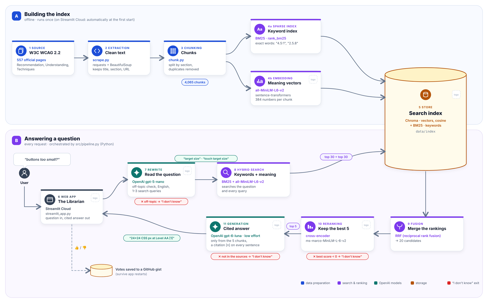

# 📚 The Librarian: a cited WCAG 2.2 assistant

**Live app: [https://librarian-wcag.streamlit.app/](https://librarian-wcag.streamlit.app/)**

A retrieval-augmented (RAG) question-answering service over the official **W3C WCAG 2.2**
documentation (557 pages: the Recommendation, *Understanding WCAG 2.2* and *Techniques for WCAG 2.2*).
It answers developers' accessibility questions **only from the official documents**, **cites every
claim**, and says **"I don't know"** when the documents do not contain the answer.



CS496 AI Engineering · Project 2 · Dr Abdeldjalil Labed · MedTech · Fall 2026

---

## Setup

```bash
pip install -r requirements.txt     # Windows: py -m pip install -r requirements.txt
```
Create a `.env` file in the project root with your OpenAI key (never commit it):
```
OPENAI_API_KEY=sk-...
```
The search index (BM25 + Chroma) is built automatically from `data/chunks.jsonl` the first time it is
needed (1–2 minutes). To rebuild it by hand: `python -m src.index`.

## Run

```bash
python -m streamlit run streamlit_app.py     # web app (the deployed version)
python -m uvicorn src.server:app             # optional: FastAPI + web/index.html on http://127.0.0.1:8000
```
**API (FastAPI version):** `POST /api/ask` with `{"question": "..."}` returns the answer, citations,
retrieved passages and latency. `POST /api/feedback` with `{"question", "answer", "helpful"}` saves 👍/👎.

## Deployment

Deployed on **Streamlit Community Cloud** from the `main` branch (`streamlit_app.py`).
- Secrets (Streamlit → Settings → Secrets): `OPENAI_API_KEY`, plus `GITHUB_TOKEN` (gist permission only)
  and `GIST_ID` for the votes.
- `data/index` is not in git: the app builds the index on its first start (`src/retrieve.py`).
- Votes are saved to `data/feedback.jsonl` **and** to a secret GitHub gist, because Streamlit Cloud
  deletes local files when the app restarts.
- `requirements.txt` installs CPU-only PyTorch and `pysqlite3-binary` (Chroma needs a newer SQLite).

Why Streamlit Cloud: Render's free tier (512 MB RAM) and Vercel's Python functions (250 MB) are too
small for PyTorch + the two local models + Chroma.

## How it answers a question

| Step | What | Model / tool |
|---|---|---|
| 0. Index (offline) | 557 W3C pages → 4,065 chunks with title / section / URL; BM25 + vector index | `src/scrape.py`, `src/chunk.py`, `src/index.py` |
| 1. Rewrite | Off-topic check, clean English question, 1–3 WCAG search queries (vague questions, typos, other languages, multi-part questions); retried once if the reply is unusable | gpt-5-nano, low effort |
| 2. Search | Hybrid BM25 + vector search (RRF) for the original question and each query | `src/retrieve.py` (rank_bm25 + Chroma, all-MiniLM-L6-v2) |
| 3. Rerank | Keep the 5 most relevant chunks | cross-encoder ms-marco-MiniLM-L-6-v2 |
| 4. Answer | Answer only from the 5 chunks, a citation `[n]` on every sentence, conformance level stated, same language as the question | gpt-6-luna, low effort |
| 5. Checks | Uncited conclusions at the end are removed; citations mapped to chunk ids | `src/pipeline.py` |

**Three "I don't know" checks:** the rewriter marks the question off-topic (no search, no answer call) ·
the best rerank score is below 0 (no answer call) · the answer model says it doesn't know.

## Results

**Retrieval** (112 answerable eval questions; a hit = a retrieved chunk contains the gold passage):

| System | R@1 | R@5 | R@10 | MRR@10 | Search p50 |
|---|---|---|---|---|---|
| BM25 only | 0.59 | 0.85 | 0.92 | 0.69 | 12 ms |
| Vector only | 0.47 | 0.72 | 0.80 | 0.58 | 9 ms |
| Hybrid | 0.56 | 0.87 | 0.96 | 0.69 | 24 ms |
| **Hybrid + reranker** | **0.72** | **0.93** | **0.96** | **0.80** | 803 ms |

**Week 8 optimisation** (full eval: 124 questions of `data/eval.jsonl`, same LLM judge gpt-4.1-mini for both):

| | Baseline (gpt-5-mini, default effort) | Final (gpt-6-luna, low effort) | Change |
|---|---|---|---|
| Cost per request | $0.003208 | **$0.000387** | **−88%** ✅ |
| p95 latency | 34.7 s | 12.6 s | −64% |
| Accuracy | 74.2% | 75.8% | +1.6 pts ✅ (rule: lose at most 2) |
| "I don't know" accuracy | 86.3% | 95.2% | +8.9 pts |
| Faithfulness | 98.5% | 90.9% | −7.6 pts ⏳ re-run after the faithfulness fix |
| Monthly LLM cost at 100× (5,000 requests/day) | ≈ $481 | ≈ $58 | −88% |

Threshold sweep: `MIN_SCORE = 0` is kept (raising it only adds false "I don't know").
The same method was first run on Groq (gpt-oss models): −53% cost with no accuracy lost.

Details: `docs/optimisation.md` · failure cases: `docs/postmortem.md` · report: `docs/report.md`.

## Evaluation and measurement scripts

```bash
python -m eval.retrieval_eval                             # recall@k: bm25 / vector / hybrid
python -m eval.ablation                                   # + hybrid + reranker (no LLM calls)
python -m eval.generation_eval answer --version NAME      # run the pipeline on data/eval.jsonl
python -m eval.generation_eval judge  --version NAME      # LLM judge: correctness, faithfulness, citations
python -m eval.generation_eval compare baseline optimised # Week 8 before/after accuracy
python -m eval.feedback_summary                           # user feedback (👍/👎)
python -m eval.try_questions                              # 15 hard questions, printed
python -m eval.latency_cost                               # p50 / p95 latency and cost per request
python -m eval.experiment --label NAME [options]          # Week 8: speed + cost + accuracy in one run
python -m eval.rescore                                    # re-score saved hard-set answers
```
`eval.experiment` options: `--rewrite-effort`, `--answer-effort`, `--top-k`, `--min-score`,
`--skip-rewrite-if-clear`, `--cache`. Results go to `eval/results/`.
Models are set by `LLM_PROVIDER` (`openai` or `groq`), `ANSWER_MODEL` and `REWRITE_MODEL`.

## Repository

```
streamlit_app.py   the deployed web app        .streamlit/   theme
src/        scrape.py, chunk.py, index.py, retrieve.py   (data & index)
            pipeline.py, server.py                       (answering & API)
web/        index.html                                   (FastAPI web interface)
data/       chunks.jsonl, eval.jsonl, review/            (corpus chunks, eval questions)
eval/       retrieval_eval.py, ablation.py, generation_eval.py, feedback_summary.py,
            experiment.py, latency_cost.py, rescore.py, try_questions.py, review_tool.py, results/
docs/       report.md, design.md, optimisation.md, postmortem.md
```

## Contributions

- **Mayssa** (data & index): scraping, cleaning and chunking the corpus; BM25 + Chroma index; `retrieve()`.
- **Khadija** (pipeline, interface, optimisation & deployment): answer pipeline, OpenAI switch, Week 8 optimisation, web app and Streamlit Cloud deployment.
- **Maya** (evaluation & documentation): retrieval eval and ablation, generation eval with an LLM judge, threshold sweep, feedback summary.

Detailed task tracking: Bloomi.