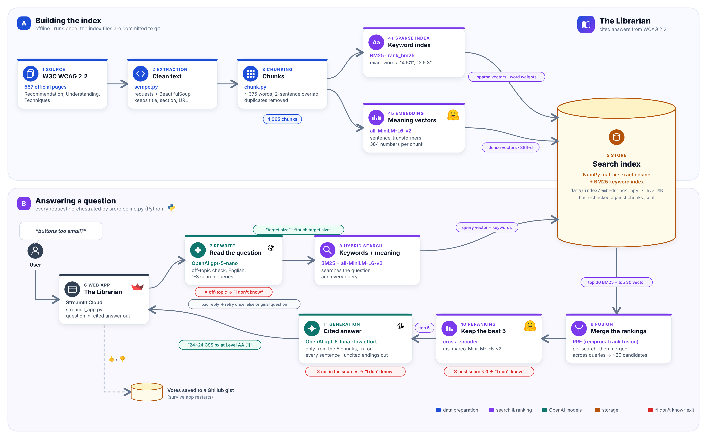

# The Librarian: cited answers from WCAG 2.2

CS496 AI Engineering · Project 2 · Dr Abdeldjalil Labed · MedTech · November 2026

Team: Khadija Chtourou, Maya Boussora, Mayssa Ghabarou · Live app: https://librarian-wcag.streamlit.app/
## Overview

The Librarian is a retrieval-augmented question-answering service over the official W3C WCAG 2.2 documentation (557 pages), for developers who need to know what the accessibility rules require. It answers only from these documents, cites every sentence, and says "I don't know" when they do not contain the answer.

*Figure 1. System overview: building the index (A) and answering a question (B).*

## Chunking

We scraped the WCAG 2.2 Recommendation, *Understanding* and *Techniques* pages, keeping the title, section and URL of every passage. Pages are split by heading, then into chunks of about 500 tokens with a two-sentence overlap, never cutting a sentence. Removing duplicate URLs and a repeated "Key Terms" glossary took the corpus from 4,749 to **4,065 chunks**.

## Embedding

Each chunk is embedded with **all-MiniLM-L6-v2** (384 dimensions), which runs locally on CPU at no cost. A **BM25** keyword index keeps exact identifiers such as "1.4.3" or "4.5:1", which embeddings tend to blur.

## Vector database

The vectors are stored in a flat **numpy file** (4,065 × 384, exact cosine search) and BM25 is built in memory. At this size exact search takes milliseconds, so a vector database would add nothing. The file is committed to git, so the deployed app needs no build step.

## Retrieval

1. **Rewrite.** A small model (**gpt-5-nano**) rejects off-topic questions and turns vague ones into 1–3 WCAG search queries. On 15 hard questions this raised the score from 8/15 to 14/15.
2. **Hybrid search.** BM25 and vector search each return their top 30, merged with reciprocal rank fusion (RRF).
3. **Reranking.** A cross-encoder (**ms-marco-MiniLM-L-6-v2**) reads the question and each candidate together and keeps the best 5. It is the largest gain in retrieval (R@1 0.56 → 0.72, Table 1). If even the best score is below 0, no answer is generated ("I don't know").

## Generation

**gpt-6-luna** (low reasoning effort) receives the 5 numbered chunks and must answer only from them, with a citation [n] on every sentence and the conformance level (A, AA or AAA) stated. Uncited closing sentences are removed. The app runs on Streamlit Community Cloud.

## Evaluation

The eval set has 122 questions (110 answerable, 12 out of scope), each with a gold passage; answers are judged by gpt-4.1-mini. The Week 8 run used the earlier 124-question version.

**Table 1.** Retrieval comparison (110 answerable questions; search time on a laptop CPU).

| Method | R@1 | R@5 | R@10 | MRR@10 | Search time |
|---|---|---|---|---|---|
| BM25 only | 0.59 | 0.85 | 0.92 | 0.70 | 36 ms |
| Vector only | 0.48 | 0.73 | 0.81 | 0.59 | 32 ms |
| Hybrid (RRF) | 0.56 | 0.86 | 0.96 | 0.69 | 70 ms |
| Hybrid + reranker | **0.72** | **0.93** | **0.95** | **0.80** | 2,779 ms |

**Table 2.** Week 8 optimisation (124 questions, same judge): low reasoning effort, and gpt-6-luna instead of gpt-5-mini.

| | Before | After | Change |
|---|---|---|---|
| Answer accuracy | 74.2% | 75.8% | +1.6 pts |
| "I don't know" accuracy | 86.3% | 95.2% | +8.9 pts |
| Faithfulness | 98.5% | 90.9% | −7.6 pts |
| Cost per request | $0.0032 | $0.00039 | −88% |
| p95 latency | 34.7 s | 12.6 s | −64% |

The target (−50% cost or p95, at most 2 accuracy points lost) is met. Faithfulness dropped mostly because of uncited first sentences, which we have since addressed in the prompt.

## What we learned

- **Retrieval decides answer quality.** Vector search alone found the right passage in the top 5 only 73% of the time; hybrid search with reranking reached 93%.
- **Users do not speak the corpus's language.** Rewriting questions into WCAG terms took our hard set from 8/15 to 14/15.
- **Measure where the cost comes from.** Most of it was hidden reasoning tokens, not context length.
- **"I don't know" is a feature.** Checks before the answer model avoid wrong answers and save money.
